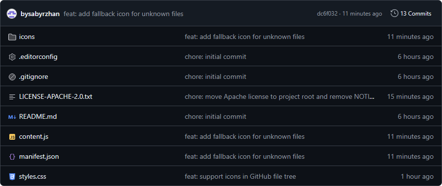
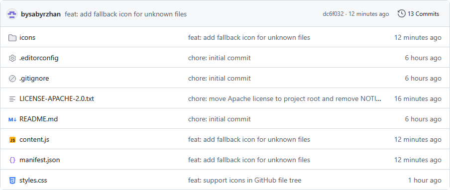

# JetBrains Icons for GitHub

---

### About

JetBrains Icons for GitHub adds theme-aware file and folder icons to GitHub repository listings and the file tree sidebar. Files with supported extensions get a matching icon; other files use the unknown-file icon.

This is an independent project and is not affiliated with or endorsed by JetBrains.

---

### Supported browsers

- Firefox
- Microsoft Edge 136 or later

The extension has been tested in both browsers.

---

### Install locally

#### Firefox

1. Open `about:debugging`.
2. Select **This Firefox**.
3. Click **Load Temporary Add-on…**.
4. Select the project's `manifest.json` file.

#### Microsoft Edge

1. Open `edge://extensions`.
2. Turn on **Developer mode**.
3. Click **Load unpacked**.
4. Select the project folder containing `manifest.json`.

After changing extension files, reload the extension and refresh the GitHub tab. Temporary Firefox add-ons are removed when Firefox closes.

---

### Supported icons

- **File extensions:** `.css`, `.html`, `.js`, `.json`, `.jsx`, `.md`, `.svg`, `.ts`, `.tsx`, `.txt`
- **Special filenames:** `.editorconfig`, `.gitignore`
- **Fallbacks:** folders use a folder icon; other files use an unknown-file icon

---

### Development

The extension uses plain JavaScript and CSS. There is no build step: edit the files, reload the extension in the browser, then refresh GitHub.

- `manifest.json` — extension metadata and browser configuration
- `content.js` — finds repository entries and selects icons
- `styles.css` — icon sizing and theme switching
- `icons/` — light and dark SVG assets

---

### Icon licenses

The included IntelliJ Platform SVG icons are licensed under Apache License 2.0, as indicated in each SVG's copyright comment. The license text is included in [`LICENSE-APACHE-2.0.txt`](LICENSE-APACHE-2.0.txt). Preserve the original copyright and license comments when modifying or redistributing the icons.
